<div align="center">
  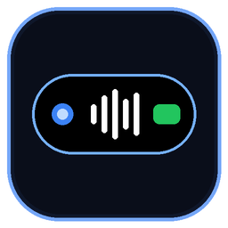
  <h1>EkPill</h1>
  <p><b>Dynamic Island &amp; Hardware-Notch Desktop Utility Capsule for Windows 10 &amp; 11</b></p>
  <p><i>One obsidian capsule at the screen edge. Native utilities inside—Quick Settings, WinRT SMTC Media, Wi-Fi &amp; Bluetooth Radios, Native Files Hub, Instant App Launcher, Settings Switchboard, and Safe Power Menu—engineered with Qt6 QML and 60 Hz Win32 click-through hit-testing.</i></p>

  <p>
    <a href="https://github.com/sidhu1512/ekpill/releases/latest/download/EkPillSetup.exe"></a>
    <a href="https://sidhu1512.github.io/ekpill/"></a>
    
    
    
    
  </p>
</div>

<p align="center">
  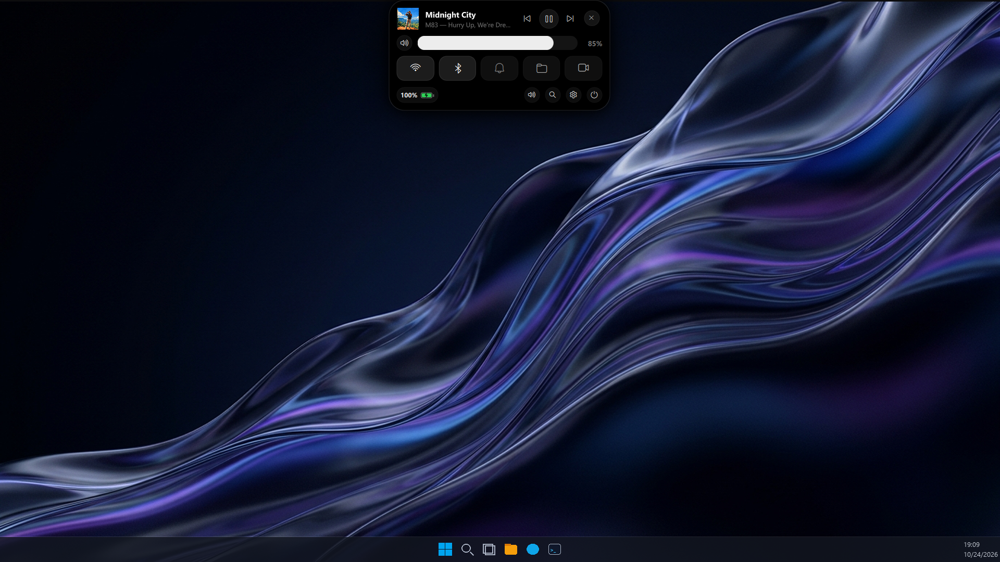
</p>

<p align="center">
  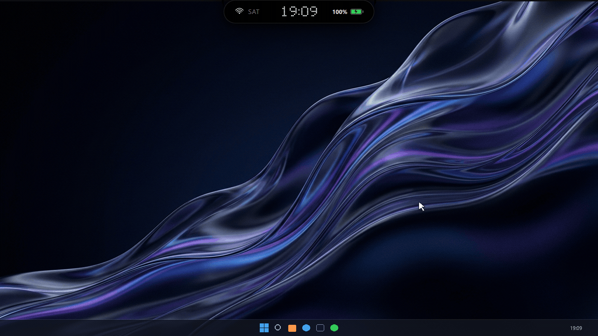
</p>

---

## Why EkPill? — One Edge Capsule Replaces Scattered Desktop Utilities

Windows 10 and 11 scatter everyday system actions across sluggish taskbar flyouts, buried Settings sub-menus, heavy Explorer windows, and third-party Electron docks that consume hundreds of megabytes of RAM while blocking mouse clicks at the top of your screen.

**EkPill is engineered differently.** Anchored flush against the **Top** (`354x50` px) or **Right** (`68x198` px) monitor edge with GPU-antialiased concave fillets, EkPill runs a **60 Hz Win32 `WS_EX_TRANSPARENT` hit-test loop**. Outside the live QML capsule bounding box, clicks pass straight through to your active titlebar or browser tabs. Hover or click the capsule to morph with damped spring physics (`spring: 3.8, damping: 0.32`) into cohesive desktop utilities.

| Capability / Architecture | **EkPill v1.3** | Windows Taskbar / Action Center | Rainmeter Skins | Generic Dock Clones |
| :--- | :---: | :---: | :---: | :---: |
| **Hardware-Notch Concave Fillets** | **Yes (MSAAx4 CurveRenderer)** | No | Static bitmap masks | Rounded rectangle only |
| **60 Hz `WS_EX_TRANSPARENT` Click-Through** | **Yes (Dynamic QML Bounding Box)** | Fixed bar reservation | Blocks underlying clicks | Captures full window rect |
| **Top Horizontal & Right Upright Dock** | **Yes (Zero-Rotation Upright Glyphs)** | Bottom-locked on Win 11 | Separate skins required | Icon dock only |
| **WinRT SMTC Media + Album Art + Seeker** | **Yes (Live SMTC + WaveBars)** | Basic flyout, no EQ | Plugins frequently break | No |
| **Settings Switchboard & Rebinding** | **Yes (In-Capsule Switchboard)** | Buried in sub-menus | Manual .ini configuration | Limited |
| **Two-Step Safe Power Menu** | **Yes (Lock, Sleep, Restart, Shutdown)** | 3 clicks deep in Start | Separate plugins required | Basic shutdown only |
| **In-Capsule File Manager & Drive Jumpers** | **Yes (Quick Folders + Context Menu)** | Opens full Explorer | No | Static folder shortcuts |
| **Instant Start Menu App Launcher** | **Yes (`Ctrl+Alt+L` + `SHGetFileInfoW`)** | Web-Bing search clutter | Manual icon paths | Pinned icons only |
| **Wi-Fi WPA2/WPA3 & Bluetooth Manager** | **Yes (Inline Password & Toggle)** | Yes | Read-only SSID text | No |
| **Privacy & Telemetry Posture** | **100% Offline (MIT Source)** | OS & Bing telemetry | Local scripts | Often proprietary / paid |

---

## Downloads & Installation

EkPill runs natively on 64-bit Windows 10 (1903+) and Windows 11.

| Package | File | Size | Description |
| :--- | :--- | :--- | :--- |
| **Windows Installer** | [EkPillSetup.exe](https://github.com/sidhu1512/ekpill/releases/latest/download/EkPillSetup.exe) | **180 MB** (`188,489,585` bytes) | Self-contained Inno Setup installer bundling Python 3.13, Qt6 QML, PySide6, WinRT bridges, and dependencies |
| **Interactive Showcase** | [sidhu1512.github.io/ekpill](https://sidhu1512.github.io/ekpill/) | **Web** | Live 5-chapter video studio, interactive Bento simulators, and 3D shortcut station |

### Checksum Verification
```powershell
Get-FileHash .\EkPillSetup.exe -Algorithm SHA256
# SHA-256: 9E03B568ABE83D9CD6DF9A84C043265469292F94BE85DF38A82868FA2AE3F29F
```

---

## Visual Feature Showcase

### 1. Bilateral Spring Morphing & Dual-Edge Orientation (`Top` & `Right`)

<p align="center">
  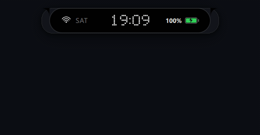
</p>

<table>
  <tr>
    <td width="50%" valign="top">
      <h3>Hardware-Notch Concave Fillets &amp; 60 Hz Click-Through</h3>
      <p>EkPill blends directly into the monitor bezel using custom concave corner fillets rendered with hardware antialiasing and a custom dot-matrix LED clock (5x7 dot matrix).</p>
      <ul>
        <li><b>Damped Spring Physics:</b> Width and height transitions use <code>SpringAnimation { spring: 3.8; damping: 0.32 }</code> for responsive, non-linear motion.</li>
        <li><b>60 Hz Win32 Hit-Testing:</b> A 16 ms cursor poll checks whether the pointer lies inside the live QML capsule rectangle and toggles <code>WS_EX_TRANSPARENT</code> instantaneously.</li>
        <li><b>Upright Right-Edge Dock:</b> Switching to the Right screen edge morphs the capsule into a <code>68x198</code> vertical dock where every clock digit, day label, battery badge, and Wi-Fi glyph remains upright.</li>
      </ul>
    </td>
    <td width="50%" valign="top">
      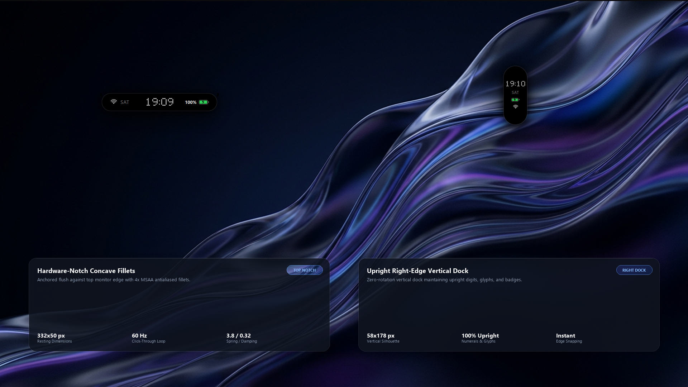
    </td>
  </tr>
</table>

---

### 2. WinRT SMTC Media Studio & Responsive WaveBars

<p align="center">
  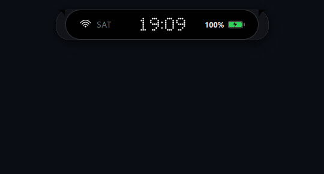
</p>

<table>
  <tr>
    <td width="50%" valign="top">
      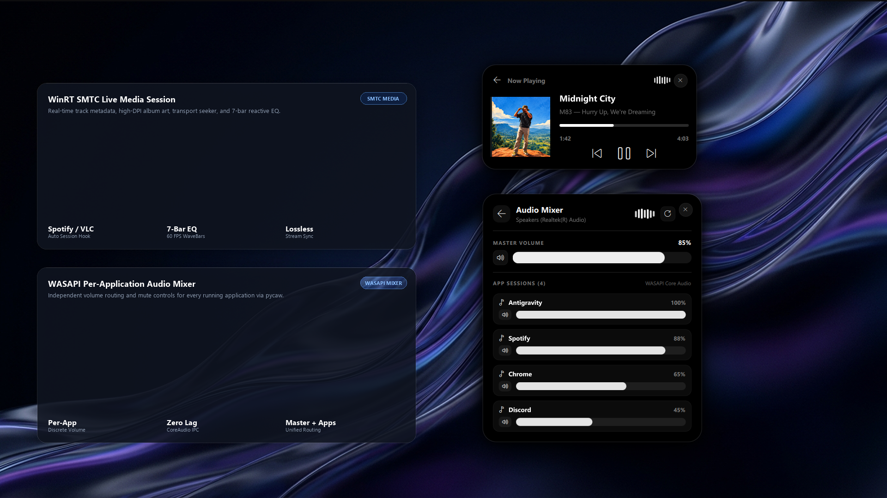
    </td>
    <td width="50%" valign="top">
      <h3>Native Media Session &amp; Interactive Playback Controls</h3>
      <p>Control playback and inspect active media without leaving your current window:</p>
      <ul>
        <li><b>WinRT SMTC Integration:</b> Reads real-time track title, artist, album art thumbnail streams, and timeline position from Spotify, Chrome, Apple Music, or VLC via <code>GlobalSystemMediaTransportControlsSessionManager</code>.</li>
        <li><b>Responsive WaveBars Visualizer:</b> Custom QML <code>WaveBars</code> component animates whenever media is actively playing.</li>
        <li><b>Scrubber Seek Bar &amp; Transport:</b> Scrub directly to any point in the active track with tactile previous, play/pause, and next transport buttons.</li>
      </ul>
    </td>
  </tr>
</table>

---

### 3. Native Files Hub & Instant App Launcher (`Ctrl+Alt+L`)

<p align="center">
  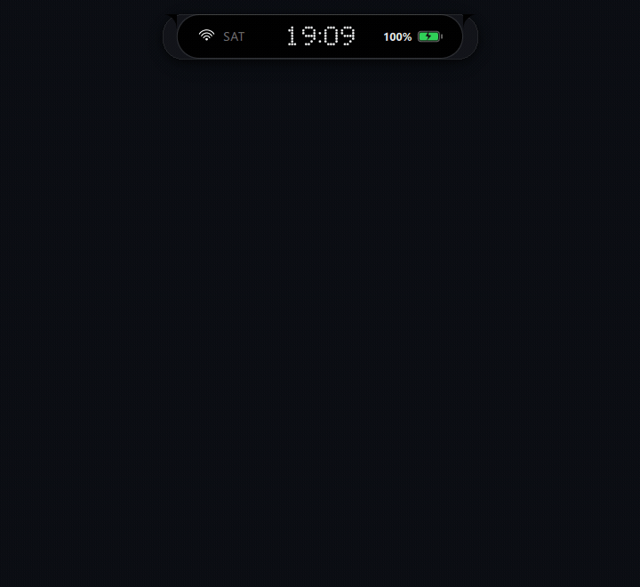
</p>

<table>
  <tr>
    <td width="50%" valign="top">
      <h3>In-Capsule File Operations &amp; Native Win32 Icons</h3>
      <p>Navigate directories, manage files, and launch installed applications in milliseconds:</p>
      <ul>
        <li><b>Quick Folders + Drive Jumpers:</b> Instant 1-click pills for Home, Desktop, Documents, Downloads, Pictures, and mounted drives (<code>C:</code> through <code>Z:</code>).</li>
        <li><b>In-Capsule File Actions:</b> Sort by Name, Date, or Size, filter in real time, create folders, and right-click any entry to Open, Rename, Copy, Cut, Paste, or send to the Windows Recycle Bin (<code>SHFileOperationW</code>).</li>
        <li><b>Global <code>Ctrl+Alt+L</code> App Launcher:</b> Indexes Start Menu shortcuts and extracts genuine 32x32 Win32 application icons via <code>SHGetFileInfoW</code> and <code>CreateDIBSection</code>.</li>
      </ul>
    </td>
    <td width="50%" valign="top">
      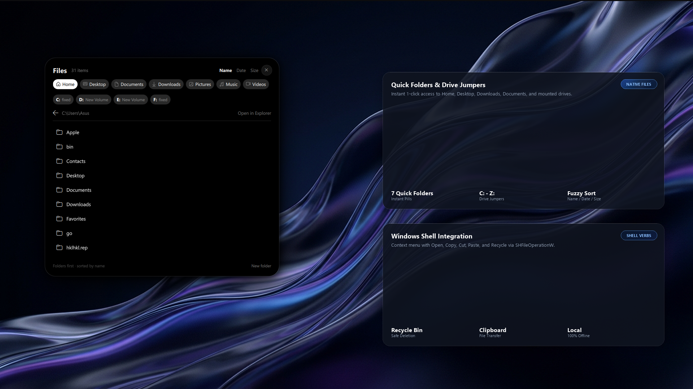
    </td>
  </tr>
</table>

---

### 4. Quick Settings Deck, Wi-Fi Scanner & Bluetooth Manager

<table>
  <tr>
    <td width="50%" valign="top">
      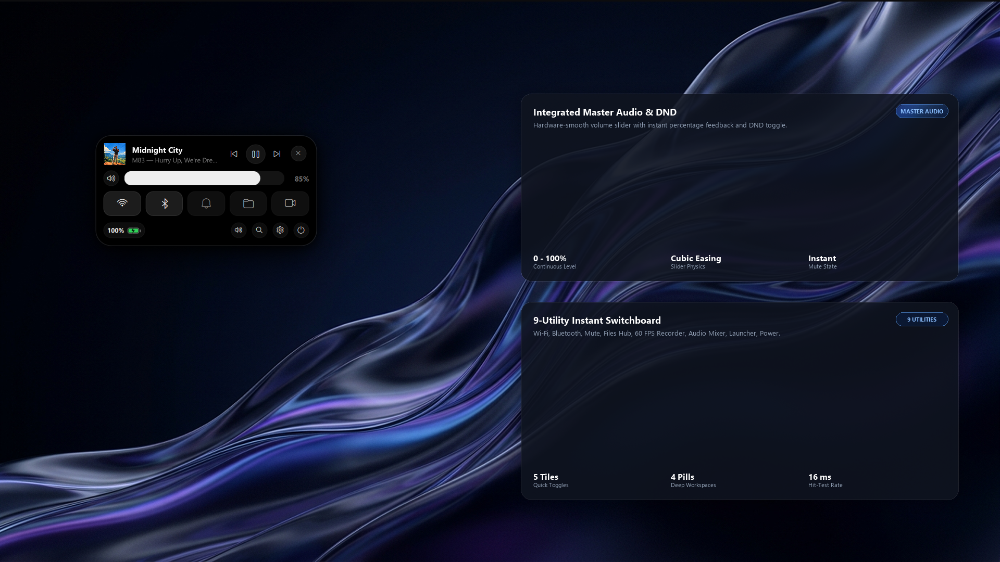
    </td>
    <td width="50%" valign="top">
      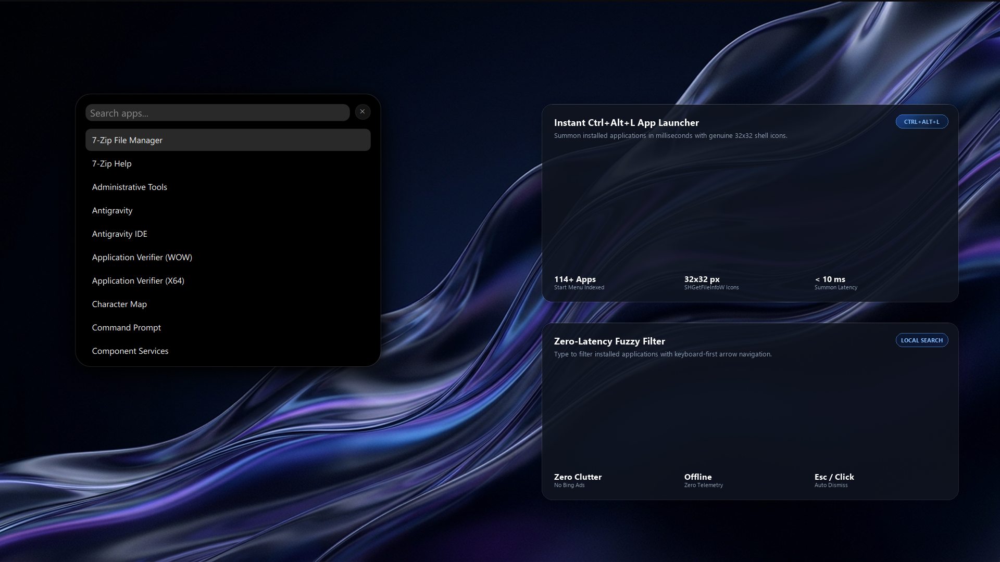
    </td>
  </tr>
</table>

- **Quick Settings Control Deck:** Features a top Now Playing media strip (click album art to expand the full Media Studio), a smooth master volume slider (`Behavior on width` cubic easing), hardware-style action pods (Wi-Fi, Bluetooth, Focus/DND, Files), and a bottom utility bar (Settings, App Launcher, Power).
- **Wi-Fi & Bluetooth Radios:** Scans nearby 802.11 networks via `netsh wlan show networks mode=bssid`, supports inline WPA2/WPA3 password entry and XML profile connection, and manages Bluetooth radio state and paired peripherals via WinRT `Windows.Devices.Radios`.
- **Focus / Do Not Disturb:** Quickly toggle system notification focus mode directly from the hardware pod.

---

### 5. Settings Switchboard & Two-Step Safe Power Menu

<p align="center">
  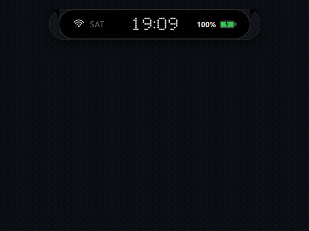
</p>

<table>
  <tr>
    <td width="50%" valign="top">
      <h3>Tactile Hardware Preferences &amp; Safe Power Controls</h3>
      <p>Configure capsule behavior and manage system power safely without accidental triggers:</p>
      <ul>
        <li><b>Edge Selector Switchboard:</b> Switch instantaneously between Top Hardware Notch (`354x50` px) and Right Upright Dock (`68x198` px) with animated spring geometry.</li>
        <li><b>System Preferences:</b> Toggle start-with-Windows autostart, configure auto-hide delays, and customize global activation hotkeys.</li>
        <li><b>Two-Step Safe Power Menu:</b> Provides Lock (`LockWorkStation`), Sleep (`SetSuspendState`), Restart, and Shutdown with an inline two-step confirmation bar to prevent accidental session loss.</li>
      </ul>
    </td>
    <td width="50%" valign="top">
      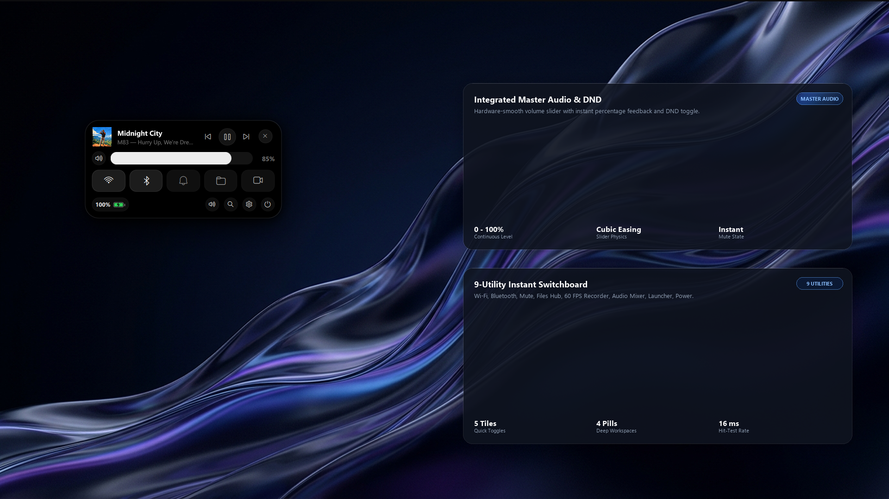
    </td>
  </tr>
</table>

---

## Systems Architecture & Hardened Execution

EkPill decouples high-frequency 60 FPS QML animations and Win32 window hit-testing from background OS I/O using worker threads and Qt Signals.

```
                         +----------------------------------------------+
                         |         EkPill Qt6 QQuickView Overlay        |
                         |  Frameless / Always-On-Top / Transparent     |
                         |  60 Hz Win32 WS_EX_TRANSPARENT Hit-Testing   |
                         +----------------------+-----------------------+
                                                |
                    Qt Properties, Signals & @Slot Bridge (backend/bridge.py)
                                                |
     +--------------------+---------------------+---------------------+--------------------+
     |                    |                     |                     |                    |
+----v-----+        +-----v----+          +-----v----+          +-----v----+         +-----v----+
| WinRT    |        | Netsh &  |          | Win32    |          | Settings |         | Shell    |
| SMTC     |        | WinRT    |          | Shell32  |          | Switch-  |         | Power    |
| Media    |        | Radios   |          | Icons &  |          | board    |         | Controls |
| Session  |        | (WiFi/BT)|          | Recycle  |          | Engine   |         | (Lock/SD)|
+----------+        +----------+          +----------+          +----------+         +----------+
```

### Security & Stability Guarantees
- **100% Offline & Zero Telemetry:** EkPill makes zero outbound network connections. All user preferences are stored locally in `~/.ekpill_config.json`.
- **Non-Blocking Background Daemons:** Slow OS queries (`winrt` media sessions, `netsh wlan` scans, PowerShell Bluetooth enumeration, and Start Menu `.lnk` icon extraction) execute on background daemon threads so the 60 FPS QML render loop never stutters.
- **Subprocess Creation Flags:** All system commands (`netsh`, `powershell`) run with `CREATE_NO_WINDOW` (`0x08000000`) to prevent console window flashes.
- **Two-Step Power Confirmation:** Destructive power operations require deliberate two-step confirmation.

---

## Keyboard Shortcuts & Mouse Triggers

| Trigger / Shortcut | Context | Action |
| :--- | :--- | :--- |
| `Ctrl+Alt+L` | Global (Win32) | Summon EkPill directly to the Instant App Launcher & focus search input |
| `Alt+E` | Global (Win32) | Toggle dock edge between Top Hardware Notch and Right Upright Dock |
| `Esc` | Expanded Panel | Unpin and collapse any open utility panel back to the edge capsule |
| `Hover Capsule` | Screen Edge | Disable `WS_EX_TRANSPARENT` and expand Quick Settings (`150 ms` debounce) |
| `Click Capsule` | Screen Edge | Expand and **pin** the panel open so it stays visible when cursor leaves |
| `Outside Click` | Anywhere on Desktop | Auto-dismiss unpinned/pinned panel and pass click through to underlying app |
| `Right-Click Tray` | System Tray | Quick access to Open, Settings, and Quit |

---

## Building & Verifying from Source

### Prerequisites
- Windows 10 (1903+) or Windows 11 (x64)
- Python 3.11 – 3.13
- Node.js 20+ (for building the interactive showcase website in `website/`)

### Development & Automated Verification
```powershell
# Clone the repository
git clone https://github.com/sidhu1512/ekpill.git
cd ekpill

# Install Python dependencies
pip install -r ekpill/requirements.txt

# Launch EkPill desktop capsule
python ekpill/main.py

# Run automated verification suites
python ekpill/verify.py
python ekpill/test_interactive_features.py
python ekpill/operate_all_panels_live.py
```

### Building the Showcase Website
```powershell
npm --prefix website install
npm run website:build
npm run website:verify
```

---

## Documentation

- [Architecture & Module Reference (`docs/PROJECT.md`)](docs/PROJECT.md)
- [Verification & Test Suite Guide (`docs/TESTING.md`)](docs/TESTING.md)
- [Release History & Changelog (`docs/UPDATES.md`)](docs/UPDATES.md)

## License

EkPill is released under the [MIT License](LICENSE).
Built by [Siddharth](https://github.com/sidhu1512).
